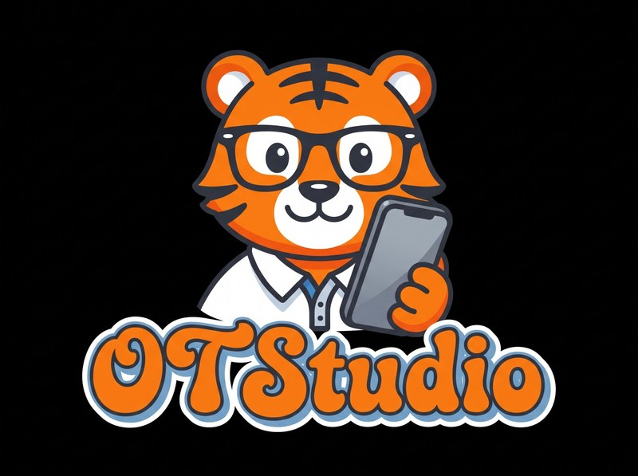
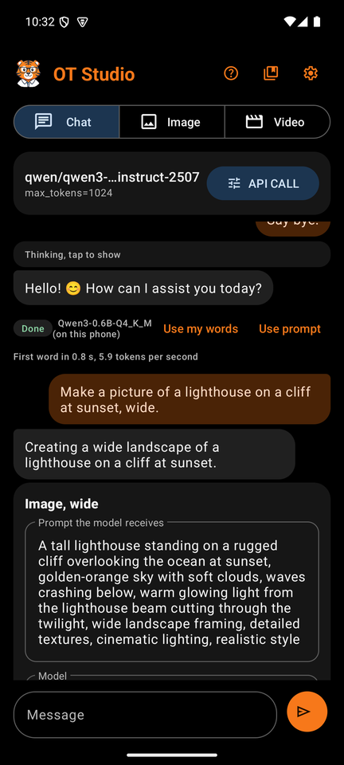
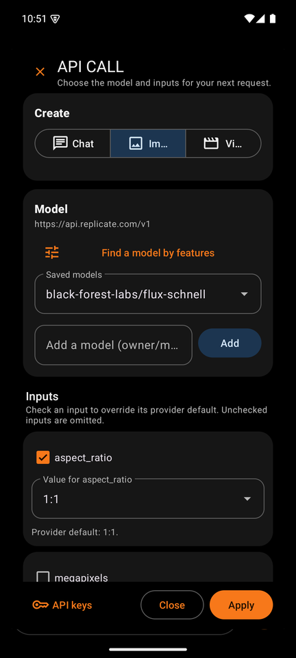
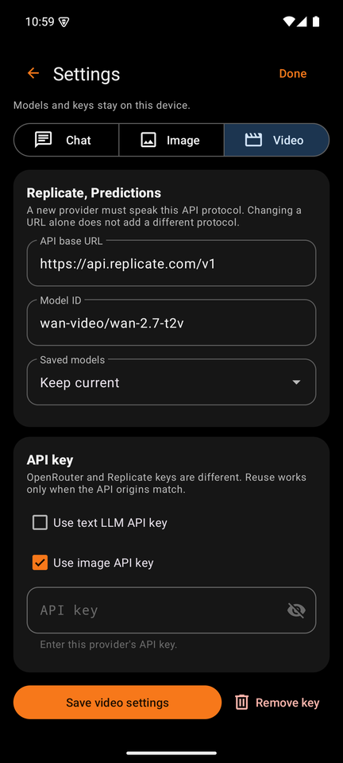
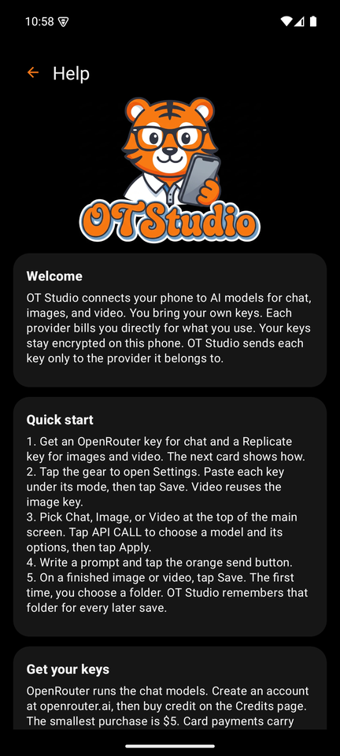

<p align="center"></p>

# OT Studio

OT Studio is an Android app for chat, images, and video. Chat runs on the phone with a free downloaded model, or through OpenRouter. Images, edits, and video come from Replicate. You bring your own keys. Each provider bills you directly, so you pay only for what you make.

OT Studio also runs on Windows and Linux as a [desktop app](https://github.com/Orangeriger1998/OTStudio-PC) that shares its LoRA files with the phone. The [OT Studio website](https://orangeriger1998.github.io/OTStudio/) has the downloads for all three platforms.

<p align="center">




</p>

The full guide lives in the **[OT Studio wiki](https://github.com/Orangeriger1998/OTStudio/wiki)**. It explains every screen box by box and walks through each workflow, from a first photo to a video that keeps one face from start to finish.

## What it does

- **Chat on the phone** with a downloaded model, offline and free per message, or with OpenRouter models such as Mistral Nemo.
- **Create by chatting.** Ask for a picture, an edit, or a video in plain words. A job card shows the exact prompt, the model, and the likely cost before you tap Generate.
- **Edit an image** from a plain instruction with Replicate editing models, or turn the camera around a subject with Qwen Edit Multi-angle.
- **Memory** for standing instructions, and **web search** on Wikipedia or with a free Tavily key.
- **Images** with FLUX schnell, FLUX dev, FLUX Krea dev, Qwen Image 2512, Z-Image Turbo, P-Image, FLUX 1.1 Pro, FLUX dev with your own LoRA, and Qwen Image with your own LoRA.
- **Video** with WAN 2.7 and WAN 2.2, from text or from starting and ending frames.
- **Photos as inputs.** The photo button in the message bar adds a photo from the phone in any mode. The chat can edit or animate it, and Image and Video can use it as a reference or a frame. A finished image can become the next reference or frame in one tap.
- **Expand** to give a picture a new shape, such as wide or tall, around the unchanged original.
- **Upscale 2x** to bring a 1024 by 1024 image to about 2048 by 2048.
- **API CALL**, a panel that shows each model's real inputs and filters models by feature.
- **LoRA training and a LoRA library.** Train FLUX dev or Qwen Image LoRAs from the phone in your own Replicate account, or import LoRAs from OT Studio for Windows, the **OT Studio LoRA Trainer** (a standalone Windows program on the Releases page), or the included script.

## Requirements

OT Studio needs Android 10 or later and an internet connection. Most phones sold since 2019 qualify. Chat on the phone works best with 8 GB of memory and needs about 2.4 GB of space for the model. Images and video need a Replicate account with a little credit. OpenRouter is optional, for larger online chat models.

## Install

1. On your phone, open the [Releases](https://github.com/Orangeriger1998/OTStudio/releases) page and download the newest `OT-Studio-x.y.z.apk`.
2. Open the file. When Android asks, allow your browser or file app to install apps.
3. Tap Install, then Open.

The app is not on the Play Store. A newer APK from Releases installs over the old one and keeps your history and keys.

## Get your keys

**OpenRouter (chat).** Create an account at [openrouter.ai](https://openrouter.ai/sign-up) and buy credit on the [Credits](https://openrouter.ai/settings/credits) page. The smallest purchase is $5, and a card payment adds a 5.5 percent fee with an 80 cent minimum. Then create a key on the [Keys](https://openrouter.ai/settings/keys) page and copy it right away.

**Replicate (images and video).** Sign in at [replicate.com](https://replicate.com/signin) with a GitHub account. Replicate bills in advance, so add a payment method and buy credit on the [Billing](https://replicate.com/account/billing) page. Your token waits on the [API tokens](https://replicate.com/account/api-tokens) page. It starts with `r8_`.

In OT Studio, tap the gear to open Settings. Paste the OpenRouter key under Chat and the Replicate key under Image, saving each one. Video reuses the image key.

## What it costs

These typical figures come from the providers' price pages in October 2026. Prices change, so check the providers before a large project. The wiki's [Getting Started](https://github.com/Orangeriger1998/OTStudio/wiki/Getting-Started) page lists every price with its source.

**A chat message** costs nothing on the phone, and well under a hundredth of a cent with Mistral Nemo through OpenRouter. **An edit** costs 1 to 4 cents.

**Ten matching photos at about 2K.** Matching photos need a LoRA, a small add-on model trained on your own pictures. One training run costs about $1.50 to $2. Each LoRA photo then costs about three cents at 1024 by 1024, and upscaling it to 2048 by 2048 adds about half a cent. The first set of ten comes to about $2.20. After that, a new set of ten costs about 35 cents.

**One minute of video.** Video models make clips of 2 to 15 seconds, so a minute takes about twelve five-second clips. WAN 2.7 at 720p costs about $6 for the minute. At 1080p the same minute costs about $9. The faster WAN 2.2 model costs about 60 cents at 480p, with visibly lower quality. Making a LoRA starting frame for each clip adds about 40 cents.

## Limits

OT Studio makes one photo or one clip at a time. Make it longer extends a video part by part from its last frame and joins the parts on the phone. Music and titles need another app. Use a video editor for that final step, such as CapCut on a phone or any desktop video editor.

LoRA training runs from the phone's LoRA library, or on a computer with the LoRA Trainer or `scripts/train_lora.py`. WAN video models cannot load a FLUX LoRA, so the wiki shows how to keep a face consistent with LoRA keyframes instead.

Replicate deletes results made through its API after about an hour. OT Studio downloads each result as soon as it finishes, but save the ones you want to keep.

The app has no cloud backup. Removing it deletes your history, your saved keys, your LoRA library, and every unsaved file.

## Privacy and security

OT Studio has no server of its own and collects no analytics. Chat on the phone keeps messages on the phone; only web search words leave it, and Allow web search turns that off. Keys are encrypted with the Android Keystore and never leave the phone except to the provider they belong to. Settings blocks screenshots in release builds. The app never sends a key to a storage host, and it never retries a paid request on its own. [docs/PRIVACY.md](docs/PRIVACY.md) covers the details.

## Build from source

You need JDK 17 and the Android SDK with platform 35 and build-tools 36.0.0.

```
gradlew :app:testDebugUnitTest :app:lintDebug :app:assembleDebug
```

To build a signed release on Windows, set `JAVA_HOME` and `ANDROID_HOME`, then run:

```
scripts\build-release.ps1
```

The script runs the tests and lint, builds the minified release, and signs it. On its first run it creates a signing key in `%USERPROFILE%\OTStudioSigning`, outside the project. Back that folder up privately. Every later release must use the same key, or Android refuses to update the installed app.

## Project layout

| Path | Contents |
|---|---|
| `app/src/main/java/com/orangetiger/otstudio` | The Kotlin app: screens, provider calls, storage, and validation |
| `app/src/main/assets/help.txt` | The in-app Help text |
| `app/src/test` | Unit tests, including screen tests that run under Robolectric |
| `scripts/train_lora.py` | The computer-side LoRA training helper, with its tests |
| `scripts/lora_trainer_app.py`, `scripts/build-trainer.ps1` | The Windows LoRA Trainer window and its standalone build |
| `scripts/build-release.ps1` | The signed release build |
| `docs` | Provider contracts, privacy notes, and LoRA training details |
| `branding` | The OT Studio logo and tiger artwork |

## License

OT Studio is free software under the [GNU General Public License, version 3](LICENSE). You may use, study, change, and share it under that license. It comes with no warranty, and the authors accept no liability for its use, as sections 15 and 16 of the license state. Provider charges are between you and each provider.

The license covers the code, not the OT Studio name or artwork. [TRADEMARKS.md](TRADEMARKS.md) explains how to name your own build. Contributions follow [CONTRIBUTING.md](CONTRIBUTING.md).

## Credits

OT Studio is created by OrangeTiger. It uses Google's Material Components for Android and Material Symbols icons, both under the Apache License 2.0, which is compatible with the GPL. See [NOTICE.txt](NOTICE.txt) and [LICENSE-THIRD-PARTY.txt](LICENSE-THIRD-PARTY.txt).
