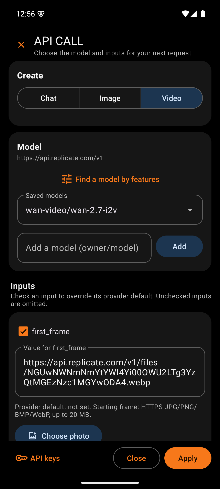
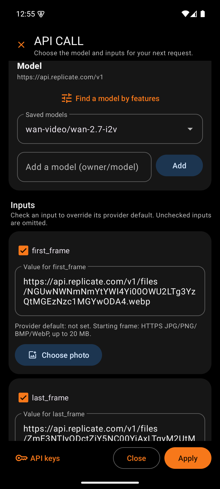
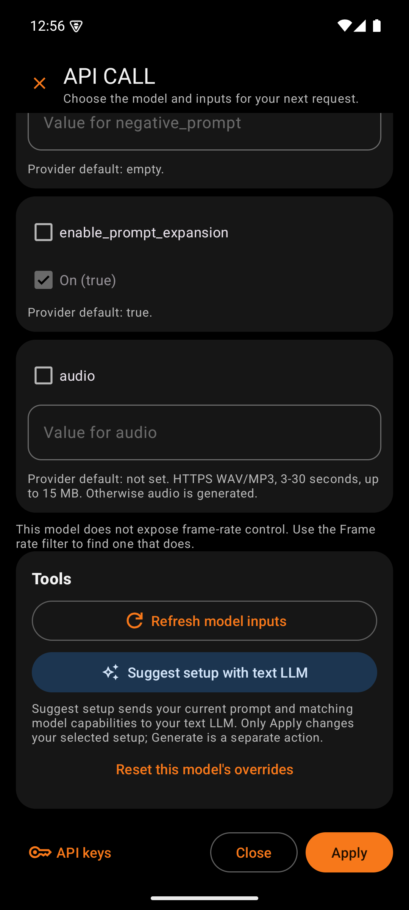
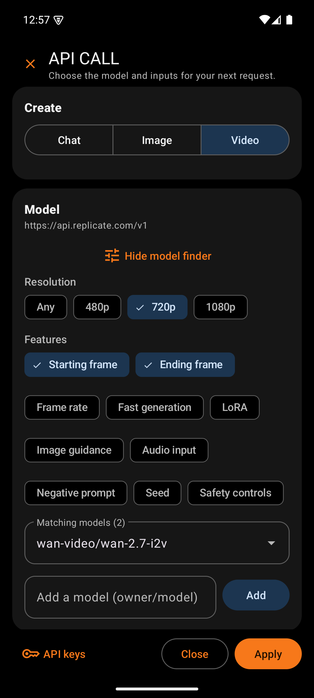

# API CALL Panel

  

API CALL is where the user chooses a model and sets its inputs. The name says what it builds: the exact request the next Generate will send. Opening the panel costs nothing. Only the Suggest setup tool sends anything, and it asks first.

The panel fills the screen, because a model can have dozens of inputs. It remembers its scroll position while it redraws, so checking a box never throws the user back to the top. It also keeps the keyboard closed until the user taps a field.

## Top bar and banners

| Box | What it holds | Why |
|---|---|---|
| Close (X) | Leaves without saving | A plain exit for browsing. Unsaved changes are dropped on purpose, because Apply is the only commit. |
| Title and subtitle | "API CALL" and "Choose the model and inputs for your next request." | States the panel's single job |
| Progress bar | Shows while inputs load, a photo uploads, or a suggestion runs | Explains why the controls are grayed out |
| Notice banner | A blue card with the latest result, such as "Inputs refreshed" or "Photo uploaded and set as image" | Sits above the scroll area, so the user sees the outcome without scrolling. Screen readers announce it. |

## Create card

| Box | What it holds | Why |
|---|---|---|
| Chat, Image, Video | A segmented button, words only | Lets the user set up another mode without closing the panel. Unapplied edits in each mode are kept until Apply or Close. |

## Model card

| Box | What it holds | Why |
|---|---|---|
| Base URL | The provider address under the card title, such as `https://api.replicate.com/v1` | Confirms which provider and which key the request will use |
| Find a model by features | A button that opens two rows of filter chips (Image and Video only) | Answers "which model can do this?" without reading every model page |
| Resolution chips | Any, 480p, 720p, 1080p | Video price and quality depend on resolution, so it is the first filter |
| Feature chips | Starting frame, Ending frame, Frame rate, Fast generation, LoRA, Image guidance, Audio input, Negative prompt, Seed, Safety controls | Each chip keeps only models whose real inputs support that feature |
| Saved models | A dropdown of the preloaded models plus any the user added. It becomes "Matching models (n)" while filters are on. | One list for every model on this provider |
| Mismatch warning | A red line when the current model fails a selected filter | Stops a user from applying a model that cannot do what they asked for |
| Add a model | A field for any `owner/model` ID, with an Add button | Any Replicate model with a compatible input schema can join the list. The app remembers it. |
| WAN 2.1 resolution | A dropdown that appears only for the WAN 2.1 models | On WAN 2.1, 480p and 720p are separate models. Choosing a resolution switches the model, which is how that provider works. |

## LoRA card

This card appears only for `black-forest-labs/flux-dev-lora`.

| Box | What it holds | Why |
|---|---|---|
| Saved FLUX dev LoRAs | A numbered dropdown of LoRAs from the [LoRA Library](Design-LoRA-Library.md), with each trigger word | Fills `lora_weights` and `lora_scale` in one step. The numbers keep two LoRAs with the same name apart. A notice then reminds the user to put the trigger word in the prompt. |

## Input cards

Each input of the model gets its own card, in the provider's order.

| Box | What it holds | Why |
|---|---|---|
| Override checkbox | The input's exact provider name, marked "(required)" when needed | A checked input is sent. An unchecked input is left out, so the provider's own default applies. Leaving inputs out avoids guessing at values the provider already chooses well. |
| Value | A dropdown for fixed choices, an On checkbox for yes or no, or a text field for numbers and text | Each input gets the control that cannot hold an invalid value. Numbers use the number keyboard. A comma typed as a decimal point is accepted. |
| Helper line | "Provider default: ..." with the allowed range and the provider's description | Shows what happens if the box stays unchecked |
| Choose photo | A button on image and frame inputs, such as `image`, `first_frame`, and `last_frame` | Opens the phone's photo picker, uploads the photo to the user's Replicate account, and fills the input. Without it, the user would need a public web address for the photo. |

Below the cards, a note lists any inputs the panel cannot edit, such as nested settings. A required input of that kind blocks the model, because the request would fail. Video models without a frame rate input show a note that points to the Frame rate filter.

## Tools card

| Box | What it holds | Why |
|---|---|---|
| Refresh model inputs | Reads the model's current inputs from Replicate (Image and Video) | Providers change their models. Refreshing keeps the input cards true to the live model. It is free and runs no generation. |
| Suggest setup with text LLM | Sends the prompt and the matching models' inputs to the chat model, then shows its suggestion for review | Helps choose a model and values for a prompt. The suggestion fills the panel only after the user taps Use in panel, and nothing generates until the user taps send. It costs one small chat request. |
| Reset this model's overrides | Restores the starting inputs for this model | Undoes experiments without hunting through every card |

## Bottom bar

| Box | What it holds | Why |
|---|---|---|
| API keys | Leaves the panel and opens Settings for this mode | Fixes a missing key in two taps. Tap Apply first to keep panel changes, because this button does not save them. Back from Settings returns to the main screen. |
| Close | Leaves without saving | Same as the X, placed near the thumb |
| Apply | Saves the model and inputs, then returns to the main screen | The single commit point. It refuses a model that fails the active filters. |
