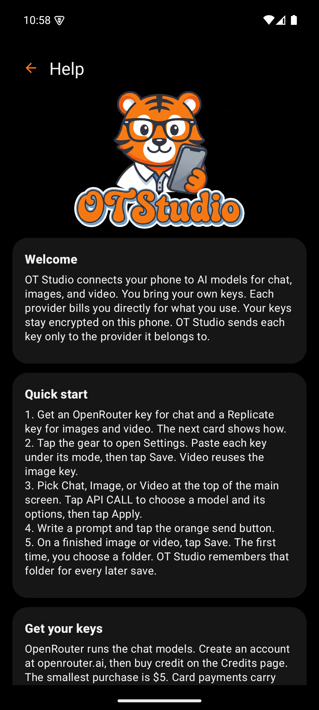
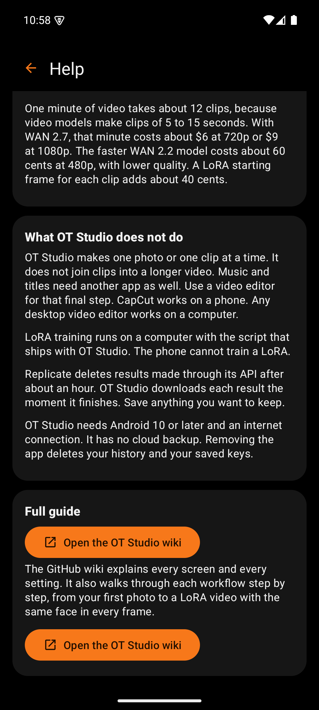

# Help Screen

 

The Help screen is the in-app README. It gives a new user enough to work without leaving the app, and it points to this wiki for the rest. The help (?) icon on the main screen opens it. So does the "How to get started" button that appears while no keys are saved.

The text lives in one file, `app/src/main/assets/help.txt`. Every heading in that file becomes a card. Keeping the help in one plain text file makes it easy to correct without touching code.

| Box | What it holds | Why |
|---|---|---|
| Back arrow and title | Returns to the main screen | Standard navigation. Back works the same way. |
| Logo | The OTStudio artwork | Ties the help to the brand the user just saw on the splash screen |
| Welcome | What OT Studio does and how keys are handled | Sets expectations about bring-your-own-key billing before anything else |
| Quick start | Five numbered steps from keys to the first save | The shortest path to a first result |
| Get your keys | How to create OpenRouter and Replicate keys, with buttons that open each provider's key page | The most common first question, answered with direct links |
| What it costs | Typical costs for chat, ten matching 2K photos, and one minute of video | Paid requests should never surprise anyone. The figures carry their date. |
| What OT Studio does not do | Limits, including that clips need a separate editor for joining and music | Honest limits save the user time looking for features that do not exist |
| Full guide | A link to this wiki | The wiki holds the procedures and the screen-by-screen design |
