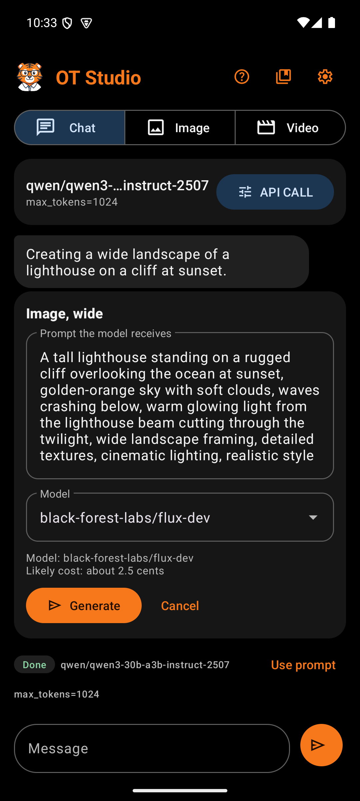

# Job Card

With Create from chat on, the user can ask for a picture, an edit, or a video in plain words. The chat model turns the request into a plan, and the plan appears under its reply as a job card. Nothing is paid for until the user taps Generate on the card.

## How a plan is made

The chat model answers every message with one small structured reply. It names the kind of job, writes the reply text, and writes the full prompt for the media model. It may also ask for a shape, a length in seconds, or one of the listed pictures. On the phone, the engine is held to that structure word by word. Through OpenRouter, the request asks for the same structure.

The chat model never picks a provider model, never writes a web address, and never starts a job. The app maps the plan onto the user's own Image, Video, or Edit model. It checks every value with the same rules as a manual request, and it drops any wish the model cannot take.

## Boxes

| Box | What it holds | Why |
|---|---|---|
| Summary | Plain words, such as "Image, square" or "5-second clip, from your picture, wide, 720p" | Says what the job makes without setting names like `aspect_ratio=1:1` |
| Picture line | "Edits the picture:" or "Starts from the picture:" with that picture's prompt | Shows which picture "that one" became. The app chose it, not the model. |
| Prompt | The exact text the media model receives, in an editable field | The chat model helps but never decides. The user can fix any word before paying. |
| Model | A dropdown of models that can do this job, starting with the user's current one | An edit lists editing models. A video from a picture lists only models that start from a frame. |
| Details | The model ID, the likely cost, and notes on dropped wishes | Each Generate is a paid request, so the price shows first |
| Generate | Starts the job | The only way a plan turns into a paid request. Each plan runs once. |
| Cancel | Closes the plan | Leaves the line "Plan canceled. Nothing was sent." in the chat |

After Generate, the result card appears in place of the job card, under the plan, with the usual [output actions](Design-Output-Actions.md). The same result also appears in the Image or Video feed.

## When no plan comes back

An expand plan, from a request such as "make it wide", shows "Expands the picture:" and a **New shape** list instead of the model list. Its text box holds what the new area should show.

Sometimes the chat model returns no usable plan. It may also answer in words when the user wanted a picture. A card then says so plainly and offers Picture from my words and Video from my words. With a chosen picture, it offers Edit the picture with my words first. Under any answer, Use my words offers the same choices. When a picture is chosen, an image, edit, or expand card also offers Make a video from it instead, and an image or expand card offers Edit the chosen picture instead. Both use the message exactly as typed. When a job fails, the chat message offers Try again with the same choices. Either one creates a job card with the user's message exactly as typed, so a missing plan is never a dead end.

## Pictures the chat can refer to

The chat model sees a short list of the newest finished pictures, each with its prompt. "That picture" means the newest one. On a picture in the chat, Talk about this marks it instead, and a line above the message bar reads "Talking about:" with a Clear button.

After a job, the conversation keeps a short note on what the app made from the plan. The model then knows which pictures exist for the next request, such as "now make it a video".

## Costs

The likely cost uses the providers' October 2026 prices: FLUX schnell less than 1 cent, FLUX dev about 2.5 cents, an edit about 1 to 4 cents, and WAN 2.7 video about 10 cents per second at 720p. A model without a known price says to check its page at Replicate.
