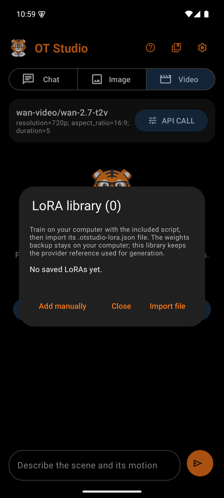

# LoRA Library

A LoRA is a small add-on model trained on your own photos. It teaches FLUX dev or Qwen Image one subject, such as a face or an art style. A trigger word in the prompt calls up a FLUX LoRA; a Qwen LoRA answers to the plain words it was trained with, such as "a person named Anna". The LoRA Library trains LoRAs and keeps them so API CALL can apply them with one tap. The library icon on the main screen's top bar opens it.

The library stores each LoRA's provider reference, not its weights. The weights stay on Replicate, so the phone never holds a large file. A LoRA runs only on its own base model: FLUX dev with a LoRA, or Qwen Image with a LoRA.

## Library dialog

| Box | What it holds | Why |
|---|---|---|
| Title | "LoRA library" | Names the dialog |
| Explanation | Training here, importing from OT Studio for Windows or the LoRA Trainer, and the two base models | Says where LoRAs come from and that each runs only on its own model |
| Train a LoRA | A tonal button | Opens the training form |
| Trainings | One card per training, newest first | Follows a training from start to finish, even after the app restarts |
| Saved LoRAs | A count, then one card per LoRA: name, base model, trigger word or words, default strength, and the provider reference | Enough to tell LoRAs apart and to remember each trigger word |
| Use for pictures | A button on each saved LoRA, and the choice offered right after a save | Switches Image to the LoRA's own model with this LoRA, and starts the prompt with its trigger word |
| Remove | A red button on each saved LoRA, with a confirmation | Takes the LoRA out of this library only; its model stays in the Replicate account |
| Import file | Opens the phone's file picker for a `.otstudio-lora.json` file | OT Studio for Windows and the LoRA Trainer write this file, so importing avoids typing a long reference |
| Add manually | Opens an empty form | For a LoRA trained elsewhere on Replicate |
| Close | Closes the dialog | Plain exit |

## Train a LoRA form

| Box | What it holds | Why |
|---|---|---|
| LoRA name | Up to 80 characters, such as "Anna face" | Names the LoRA and its private model at Replicate (`lora-anna-face`, or `lora-qwen-anna-face` for Qwen) |
| Trainer | FLUX dev (standard) or Qwen Image (alternate) | Picks the base model. The note below gives each trainer's price and time. |
| Trigger word | Suggested from the name, such as ANNAFACE; for Qwen, "How the photos describe the subject", suggested as "a person named Anna" | FLUX learns a made-up word; Qwen learns from familiar words, and every photo gets the caption "A photo of" those words |
| Steps | 1000 to start; 3 to 6000 for FLUX, 100 to 6000 for Qwen | More steps learn more and cost more |
| Photos | A count and Choose photos, which opens Android's picker for up to 20 photos | 10 or more work best. Each needs at least 512 pixels on its short side. |
| Agreement | A box: upload the photos to my Replicate account and pay for the training there | Training is billed, so nothing starts without it |
| Train | Checks the form, then asks "Start this training?" with the photo count, the steps, the trainer, and the cost | One billed training starts only after this second tap |

The phone turns each photo upright and redraws it as a JPEG of at most 2048 pixels, which also leaves out its location. It packs the photos into one ZIP, creates the private model when it is missing (and refuses a model of that name that is public), uploads the ZIP to the Replicate key saved for Image, and starts the training once. If the answer is lost, the card says the training may have started and points to replicate.com/trainings; the app never sends it again.

## Training card

| Box | What it holds | Why |
|---|---|---|
| Name and trainer | The LoRA name, the trainer, and the steps | Tells trainings apart |
| Bar | Moves from 0 to 100 percent once training steps appear in Replicate's log; before that it runs without a number | Shows progress without showing the log itself |
| Status | The stage (Describing the photos, Loading the base model, Training, or Saving the LoRA), the percentage, and the minutes left; at the end "Ready. It is in your saved LoRAs.", the reason it failed, or "Canceled." | Says what is happening in plain words |
| Check now, Cancel training | While it runs | Check now asks Replicate at once. Cancel asks for confirmation, because Replicate bills the time already used. |
| Remove from list | After it ends | Clears the card. Its LoRA stays in the library. |

Running trainings are checked about every 30 seconds while the app is open. A training that was being sent when the app closed shows that its outcome is unknown.

## Review form

Both Import file and Add manually open this form, so every entry is checked by a person before it is saved.

| Box | What it holds | Why |
|---|---|---|
| LoRA name | Up to 80 characters | The name shown in API CALL |
| Reference | `owner/model`, `owner/model/version`, or an HTTPS weights URL | Where Replicate finds the weights. A pinned version keeps results repeatable. |
| Trigger word | The word that calls up the LoRA | Shown again in API CALL as a reminder |
| Default scale | -1 to 3, usually 1 (0 to 3 for Qwen) | How strongly the LoRA shapes the image. A comma works as the decimal point. |
| Base model | FLUX dev or Qwen Image | The model the LoRA runs on. An imported file sets it. |

Saving a reference that already exists updates its name, trigger, and scale instead of adding a duplicate. The library accepts FLUX dev and Qwen Image LoRAs. WAN video models cannot load them, and the [consistent face procedure](Procedure-Consistent-Face-Video.md) explains how to carry a LoRA face into video anyway.
