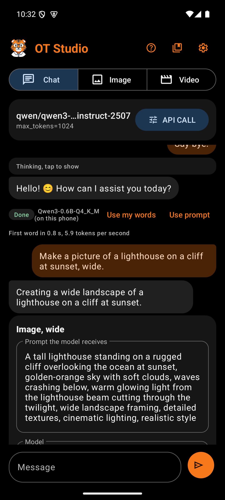
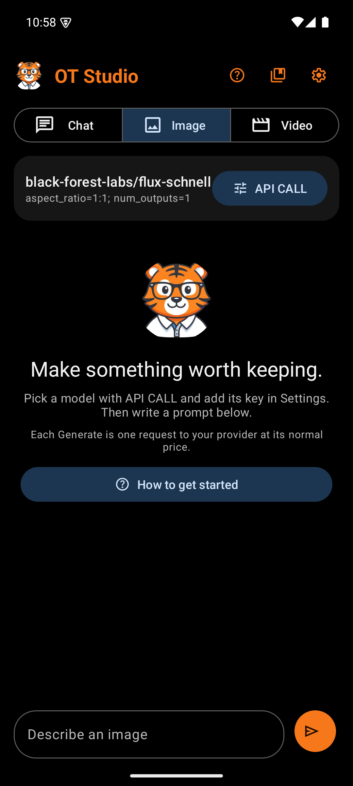
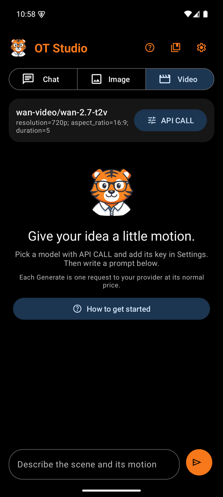

# Main Screen

  

The main screen is where every request starts and every result lands. It reads from top to bottom in the order a user works: choose a mode, check the setup, look at results, and write the next prompt.

## Top bar

| Box | What it holds | Why |
|---|---|---|
| Tiger avatar | The OT Studio tiger in a circle | Brands every session and matches the launcher icon |
| Title | "OT Studio" in bold tiger orange | Names the app on the one screen people see most |
| Help button (?) | Opens the [Help Screen](Design-Help-Screen.md) | Puts the quick start and the cost guide one tap away |
| LoRA library button | Opens the [LoRA Library](Design-LoRA-Library.md) | LoRAs work across many sessions, so the library sits outside API CALL |
| Settings button (gear) | Opens [Settings](Design-Settings.md) | Keys and providers change rarely, so a small icon is enough |

The three buttons are icons, which keeps the title readable on small phones. Each one has a spoken label and a long-press tooltip.

## Mode switch

| Box | What it holds | Why |
|---|---|---|
| Chat, Image, Video | A segmented button with one icon and one word per mode | The three modes are separate tools. A segmented button shows all three at once and makes the current one obvious in blue. |

Each mode keeps its own model, options, key, history, and unsent prompt. Switching modes never loses a draft. The draft also survives turning the phone.

## Setup card

| Box | What it holds | Why |
|---|---|---|
| Model ID | The exact model the next request will use, such as `black-forest-labs/flux-schnell` | Image and video requests cost money. The user should see the model before tapping send, not after. |
| Option summary | Plain words for the settings, such as "Image, square, safety checker off" or "5-second clip, wide, 720p". Chat through OpenRouter reads "Online chat through OpenRouter". | Shows what will change the result or the price without raw setting names. It reads "Working..." while a request runs. |
| API CALL button | Opens the [API CALL Panel](Design-API-CALL-Panel.md) | Changing the model or its inputs is the most common adjustment, so its button sits beside the summary it changes |

The model ID shortens in the middle when it is too long, so both the owner and the model name stay visible.

When Chat runs on the phone, the card changes. The title shows the chosen model's plain name. The summary tells whether that model is loaded, loading, or waiting for the first message. A Models button replaces API CALL and opens the [Model Manager](Design-Model-Manager.md), since an on-device model has no provider inputs to adjust.

## First start

On a new install, the empty Chat screen asks "Where should Chat run?" with two buttons. On this phone opens the [Model Manager](Design-Model-Manager.md), so the user can download a free model. OpenRouter, with your key opens Settings for the key. Each button explains its cost in one line. The question disappears once the user picks one, and Settings can change the choice later.

## Status area

This area appears only when needed.

| Box | When it shows | Why |
|---|---|---|
| Progress bar and "Working..." | While a request, upload, or download runs | Shows that the app is busy, so the send button's grayed state makes sense. For on-device chat it reads "Loading the model..." and then "Writing on this phone...". |
| Stop waiting | Beside "Working..." | Stops the phone from waiting on a slow connection. It does not cancel a job at the provider. |
| Stop | Beside the on-device status | Ends an on-device reply at once. The words written so far stay in the chat. |
| Error card | After a request fails | States the problem in plain words, in the error color, above the feed where it cannot be missed |

## Feed

The feed lists this mode's history, oldest at the top. It keeps its scroll position while results refresh, and it jumps to the bottom after a new send.

**Chat entries** appear as two bubbles. The user's prompt sits on the right in orange. The model's reply sits on the left in gray. A failed reply turns red. An on-device reply appears word by word as the phone writes it. Replies show simple formatting, such as bold words, headings, and bullet points. Under an on-device reply, a small line reports how long the first word took and how many tokens per second followed.

With Create from chat on, a reply that describes a picture, an edit, or a video carries a [job card](Design-Job-Card.md) under it. After Generate, the result card takes the job card's place. Pictures in the chat carry Talk about this, which marks one picture for the next message. A line above the message bar then reads "Talking about:" with a Clear button.

A reply that searched the web lists each search under it, such as "Searched Wikipedia: Nobel Prize in Literature 2024 winner", followed by the sources in blue. Tapping one opens it in the browser. Wikipedia results carry the line "Text from Wikipedia, available under CC BY-SA 4.0."

When Show the model's thinking is on, a model that thinks first shows that thinking in a separate block above its answer. The block uses small gray italic type under the label "Thinking", so it never reads as the answer. It stays open while the model writes. Afterward it folds to one line, "Thinking, tap to show". Under each pair, a status label and the model name show what happened, and Use prompt copies the prompt back into the message bar.

**Image and video entries** appear as cards.

| Box | What it holds | Why |
|---|---|---|
| Prompt | The prompt exactly as sent, selectable | Lets the user copy or reuse it |
| Status label | A colored word, explained below | Shows the job's state at a glance |
| Model | The model that made it | Results depend on the model, so the card records it |
| Request summary | The inputs sent with the job | Lets the user repeat a result they liked |
| Provider message | Progress, failure reasons, or "1 output(s) ready to preview or save" | Explains the status in a sentence |
| Job ID | The provider's job number, selectable | Finds the job in the Replicate dashboard if anything goes wrong |
| Image preview | The finished image, rounded, for the three newest entries | Shows the result without opening it. Older cards skip the preview to save memory. Tapping the preview opens the full view. |
| Action rows | See [Output Actions](Design-Output-Actions.md) | Each row scrolls sideways when the buttons do not fit |

**Status labels**

| Label | Color | Meaning |
|---|---|---|
| Done | Green | The result is saved in the app |
| Sending | Orange | The request is on its way |
| Thinking | Orange | A chat reply is on its way |
| Working | Orange | The provider is making the image or video. The app checks every six seconds while it is open. |
| Saving | Orange | The finished file is downloading to the phone |
| Canceling | Orange | A cancel request is on its way |
| Failed | Red | The provider refused the request or the job failed |
| Check dashboard | Red | The app lost contact mid-request and cannot tell whether the job started. Check Replicate before trying again, so you do not pay twice. |
| Interrupted | Red | The app closed while a chat reply was on its way |
| Stopped | Gray | The user stopped an on-device reply. The partial reply stays and counts as part of the conversation. |
| Not tracked | Red | The user chose Stop tracking. The provider job may still run. |
| Canceled | Gray | The provider confirmed the cancel |
| Download skipped | Gray | The user skipped the local download |

## Empty state

A new mode shows the tiger with a short headline. One line of guidance sits below it. Image and Video add a reminder that each Generate is a paid request. When no keys are saved yet, a "How to get started" button opens the Help screen. The empty state turns a blank screen into a first step.

## Message bar

| Box | What it holds | Why |
|---|---|---|
| Prompt field | A rounded field labeled "Message", "Describe an image", or "Describe the scene and its motion" | The label tells the user what kind of prompt each mode expects. The field grows to five lines. |
| Send button | An orange circle with a send arrow | The one primary action on the screen, so it gets the brand color. Its spoken label says Send, Generate image, or Generate video. |

The send button grays out while another request runs. After a successful send, the prompt field clears itself.
