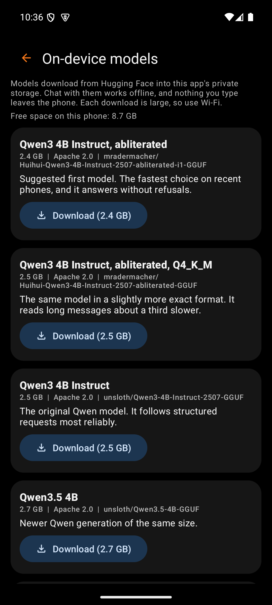

# Model Manager

The model manager downloads chat models onto the phone. Chat can then run with no key and no cost per message. Open it from Settings, under Chat, with Manage models. The Models button on the main screen opens it too while Chat runs on the phone.

Model files come from Hugging Face. OT Studio never ships one inside the app. Each file stays in the app's private storage, and Android backup skips it.

## Top bar

| Box | What it holds | Why |
|---|---|---|
| Back arrow | Returns to Settings | The phone's Back gesture does the same |
| Title | "On-device models" | Names the screen |

Below the title, a short note explains where models come from. A second line shows the free space on the phone, because each model needs 2 to 5 GB.

## Model cards

Each card describes one model file. The seven suggested models come first, followed by any the user added by link.

| Box | What it holds | Why |
|---|---|---|
| Name | A plain name, such as "Qwen3 4B Instruct, abliterated" | File names are long and technical. The plain name is easier to compare. |
| In use | A green label on the chosen model | Shows which model answers the next chat message |
| Facts | Download size, license, and the Hugging Face repository | The size decides whether the model fits. The repository tells the user where it came from. |
| Note | One sentence on what the model is good at | Helps a first-time user choose |
| Progress bar | Orange, with "Downloading 1.2 GB of 2.5 GB" | Shows how far a download has come |
| Download | Starts the download, with its size on the button | The size is visible before the tap |
| Pause | Stops the download and keeps the part already on the phone | A large download can wait for a better connection |
| Resume | Continues from where the download stopped | Nothing downloads twice |
| Use this model | Makes a downloaded model the one Chat uses | Several models can sit on the phone at once |
| Delete | Removes the file after a confirmation | Frees space. The model can be downloaded again later. |
| Remove | Takes an added link off the list before any download | Cleans up a wrong link |

After a download, the app checks the file against the size and SHA-256 checksum that Hugging Face publishes. A file that fails the check is deleted, and the card asks the user to try again. The first model to finish becomes the one in use.

On mobile data, Download first asks for confirmation, because one model can use up a data plan. The screen stays awake while a download runs. Keep OT Studio open until it finishes. A download that stops can be resumed later.

## Add a model from Hugging Face

| Box | What it holds | Why |
|---|---|---|
| Link field | A Hugging Face link to one .gguf file | Lets the user try a model outside the suggested list |
| Add to the list | Checks the link and adds a card for it | No download starts until the user taps Download on that card |

The link must start with `https://huggingface.co/` and point to a single .gguf file. The app refuses other hosts, files split into parts, and vision add-on files. A Q4_K_M file of 2 to 5 GB suits most phones.

## Where speed comes from

A model does two kinds of work. First it reads the whole conversation, and then it writes the reply one word at a time. On a Pixel 10 Pro XL, the suggested 4B model reads about 97 tokens per second and writes about 7 to 11. A token is roughly three quarters of a word. A short message therefore gets its first word in about a second. An 8B model writes better but answers about half as fast.

OT Studio carries two builds of its engine. The faster one uses instructions found in phone processors from about 2022 onward, and it reads three times faster. The app picks it by itself on a phone that supports it. Settings names the build in use.

After each reply, the app saves the conversation as the model has already read it. When the app or the model starts again, it loads that saved state instead of reading everything again. The saved state stays in the app's private storage.

The Q4_0 files read faster than Q4_K_M files of the same model, because the engine has faster code for them. The suggested model uses Q4_0, and the Q4_K_M version stays in the list for anyone who prefers it.

Settings offers two related controls under Chat. Context size sets how much of the conversation the model remembers. Processor threads exists for speed testing and should normally stay on Automatic, which uses six of the eight cores on a Pixel. More threads made it slower in testing.
