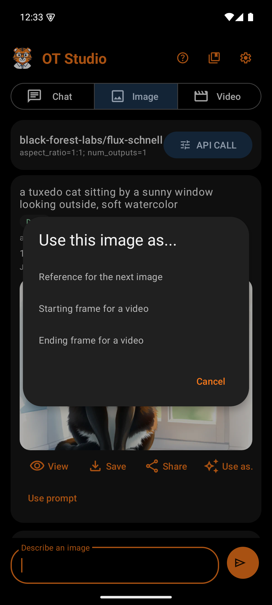
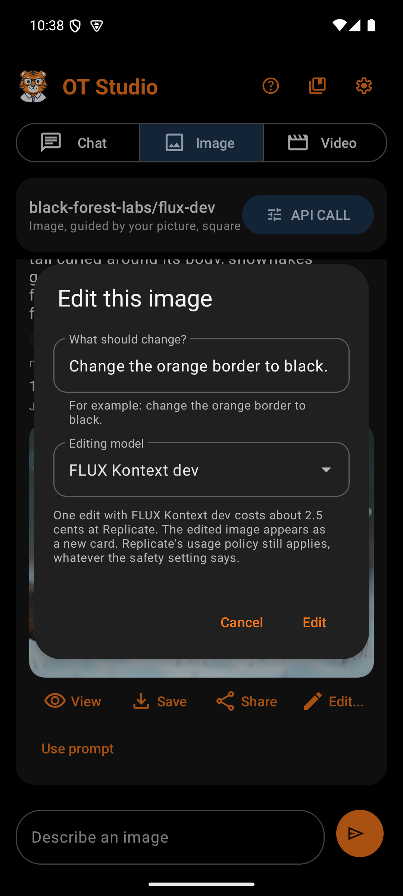

# Output Actions

Every image and video card carries two rows of buttons. The first row acts on the finished file. The second row acts on the job and its prompt. Each row scrolls sideways when the buttons do not fit.

## File actions

| Button | What it does | Why |
|---|---|---|
| View (images) | Opens the image full size in a dialog | Checks detail before saving. Tapping the preview does the same. |
| Play (videos) | Plays the clip in a dialog with play controls | Checks a clip without leaving the app |
| Save | Copies the file into the remembered save folder | The first Save asks for a folder. Later saves go straight there, so nobody browses from the top of storage each time. A snackbar confirms the folder and offers Change. |
| Make it longer | On a finished video. Asks what happens next, takes the video's last frame, and makes the next part of about 5 seconds from it with the Video model when it starts from a picture, or WAN 2.2 fast otherwise, at the first part's resolution and with the safety checker off. When the part arrives, the phone decodes both and encodes them into one video, so the new card holds the whole video. | Video models make 5 to 15 second clips. Repeating Make it longer builds a longer video one part at a time. |
| Delete | Deletes this card and its private file, after a confirmation. Not shown while a job runs. | Removes failed or unwanted results one at a time. A copy saved with Save stays. |
| Share | Opens Android's share sheet with the file | Sends a result to another app, such as email or a chat app, without saving a copy first |
| Edit... (images) | Asks what should change, then sends the image and that instruction to an editing model | Changes one thing, such as a color or an object, and keeps the rest. The result appears as a new card that names the image it came from. A picture SpicyAPI made can also go to Spicy Image Edit 1, which edits only SpicyAPI's own pictures. |
| Use as... (images) | Uploads the image and places it in a model input of your choice. A picture SpicyAPI made is not uploaded; its SpicyAPI address is placed instead, since SpicyAPI takes only its own pictures. | Chains work together. One image can become the reference for the next image, or a starting or ending frame for a video. |
| Upscale 2x (images) | Doubles the width and height with P-Image Upscale at Replicate, or with Spicy Upscale 1 at SpicyAPI for a picture SpicyAPI made | FLUX images come out at about 1024 by 1024. Upscaling reaches about 2048 by 2048 for about half a cent at Replicate, or 2 cents at SpicyAPI. The result appears as a new card. The action takes pictures up to about 2 megapixels; a larger picture gets a message that it is already large enough, and nothing is sent. |

**Use as...** offers three roles:

- **Reference for the next image** fills the `image` input of the Image model. When the current model has no such input, OT Studio switches Image to FLUX dev, which does.
- **Starting frame for a video** fills `first_frame`, or `image` on WAN 2.2. When the current Video model cannot start from an image, OT Studio switches to WAN 2.7 image-to-video. A starting frame replaces any clip set to continue, because the model accepts only one of the two.
- **Ending frame for a video** fills `last_frame`, or `last_image` on WAN 2.2, and uses the same model switch.

The upload goes to the user's own Replicate account through Replicate's Files API. A snackbar names the model that received the photo and offers to open that mode.

### The Edit dialog

| Box | What it holds | Why |
|---|---|---|
| What should change? | A text field for a plain instruction, with an example under it | Editing models follow short, direct instructions best, such as "change her jacket to a red sweater. Keep her face the same." |
| Editing model | A dropdown of nine Replicate editing models, set to the last one used | FLUX Kontext dev comes first. It made the most exact change in testing. |
| Cost line | The model's price per edit, and a reminder that Replicate's usage policy still applies | Each Edit is one paid request, so the price shows before the tap |
| Edit | Uploads the image and starts the edit | The tap is the confirmation. OT Studio never retries an edit on its own. |

Every editing model in the list exposes Replicate's `disable_safety_checker` input. OT Studio turns that checker off and sets the output to the shape of the input image. Both settings, and every other input, can change in API CALL. Replicate's usage policy still applies, whatever the switch says.

The edited image's card starts with "Edit of:" and the prompt of the image it came from. Repeated edits can drift a face away from the original. To keep a face true, edit the LoRA image again rather than an edit of an edit.

## Job actions

| Button | When it shows | What it does | Why |
|---|---|---|---|
| Repeat | On every finished or failed picture and video, except photos from the phone and upscales | For a plain picture or video: switches to its tab, puts back its model and exact inputs (shape, resolution, starting and ending pictures), and puts its words in the message bar to edit before sending. For an edit, an expansion, or a longer video: opens that dialog again, filled in. Nothing is sent until the user taps the button. | When a result is not what was hoped for, the next try starts from the same setup instead of from scratch |
| Refresh | While Working | Asks the provider for the job's state now | The app already checks every six seconds. This button is for the impatient. |
| Cancel | While Working | Asks the provider to stop the job | Stops paying for a job that is clearly wrong |
| Stop tracking | While Working | Releases a job that cannot be refreshed or canceled | Without it, one stuck job would block every new image and video. A dialog warns that the provider job may still run and charge. |
| Download again | After a failed or skipped download | Retries the download without generating again | Avoids paying twice for a finished result. Replicate keeps API results for only about an hour, so retry soon. |
| Skip download | While Saving | Gives up on the download | Frees the app when a connection is too slow |

OT Studio never retries a paid request on its own. When the outcome of a request is unknown, the card says Check dashboard, and the decision stays with the user.

## Expand

**Expand...** on a finished image gives it a new shape. The picture stays exactly as it is, centered, and FLUX Fill dev (`black-forest-labs/flux-fill-dev`) paints new picture around it until the frame has the chosen shape.

FLUX Fill dev works at about 1440 by 1440 pixels at most, so the phone does the rest. It sends a reduced copy of the larger canvas with a mask of the empty area. When the result comes back, the phone enlarges it to full size and matches its colors to the original. Then it lays the original pixels back on top, with a soft blend where the original meets the new area. The result keeps the original's resolution, up to 4096 pixels on the long side.

| Box | What it holds | Why |
|---|---|---|
| Size line | The picture's size in pixels, such as "1024 by 1024 pixels" | Shows the shape the picture has now |
| New shape | Wide 16:9, Tall 9:16, Square 1:1, and the 3:2, 2:3, 4:3, 3:4, 5:4, and 4:5 frames | The common photo and screen shapes |
| What should the new area show? | An optional plain description, such as "more of the beach and the sky" | Steers what fills the new area. Left empty, the model continues the scene on its own. |
| Cost line | About 4 cents per expansion | Each Expand is one paid request |

The result appears as a new card that begins with "Edit of:" and the original's prompt, so the original stays. The safety checker is switched off, as on the other models. In Image, the photo button offers **Expand it to a new shape** as well. In Chat, a request such as "make it wide" gives an expand job card with a **New shape** list in place of the model list.

