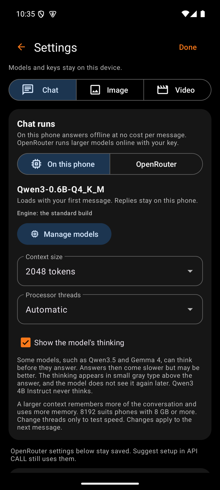
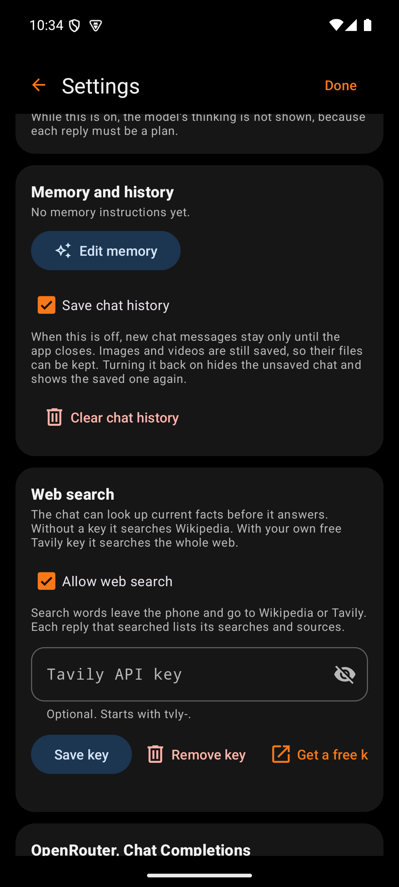
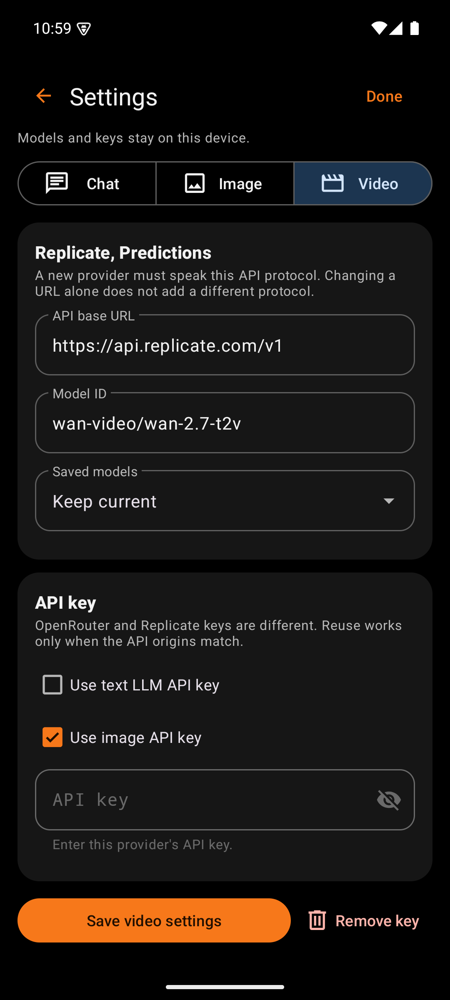
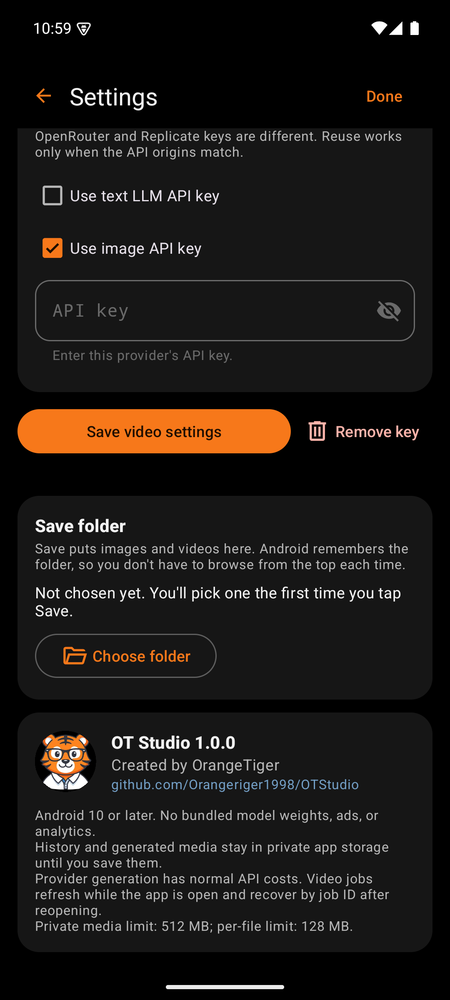

# Settings

   

Settings holds what changes rarely: where chat runs, the provider address, the default model, the key, and the save folder. Release builds block screenshots and screen recording on this screen, so a key never lands in a capture.

## Top bar

| Box | What it holds | Why |
|---|---|---|
| Back arrow | Returns to the main screen | Standard Android navigation. The phone's Back gesture does the same. |
| Title | "Settings" | Names the screen |
| Done | Returns to the main screen | A plain exit for users who look for a word rather than an arrow. Done does not save. Each card has its own Save. |

Under the title, one line reminds the user that models and keys stay on this device.

## Mode switch

| Box | What it holds | Why |
|---|---|---|
| Chat, Image, Video | A segmented button | Each mode has its own provider, model, and key, so Settings edits one mode at a time |

## Chat runs card

This card appears only under Chat.

| Box | What it holds | Why |
|---|---|---|
| On this phone, OpenRouter | A segmented button | Chooses where chat replies come from. The choice applies at once. |
| Model name and state | The chosen on-device model, and whether it is loaded | Shows what will answer the next message |
| Engine line | "the faster build for this processor" or "the standard build" | Explains the speed a phone gets. The app chooses the build itself. |
| Manage models | Opens the [Model Manager](Design-Model-Manager.md) | Downloads, chooses, and deletes on-device models |
| Context size | 2048, 4096, 8192, or 16384 tokens, default 8192 | A larger context remembers more of the conversation and needs more memory |
| Processor threads | Automatic, or 2, 4, 6, or 8 | For speed testing on a particular phone. Automatic suits nearly every phone. |
| Show the model's thinking | A checkbox, off by default | Lets models such as Qwen3.5 and Gemma 4 think before they answer. Answers then take longer. The thinking appears apart from the answer, and the model does not see it again later. |

The model name, Manage models, and the two dropdowns appear only while On this phone is selected. A note under the card says that the OpenRouter settings below stay saved, because Suggest setup in API CALL still uses them.

## Create from chat card

This card appears only under Chat.

| Box | What it holds | Why |
|---|---|---|
| Create images and videos from chat | A checkbox, on by default | Turns each chat reply into a plan. A plan for a picture, an edit, or a video shows as a [job card](Design-Job-Card.md). Off brings back plain chat. |
| Note | Says that thinking is not shown while this is on | A plan must be a structured reply, so the model cannot think out loud first |

## Web search card

This card appears only under Chat.

| Box | What it holds | Why |
|---|---|---|
| Allow web search | A checkbox, on by default | Lets the chat look up current facts before it answers. Off keeps every message on the phone. |
| Note | Says that search words leave the phone and that replies list their searches | The user knows what is sent and where |
| Tavily API key | A password field, optional, with a status line | Without a key the chat searches Wikipedia. A free Tavily key searches the whole web. The key is encrypted and goes only to Tavily. |
| Save key, Remove key, Get a key | Buttons | Get a key opens Tavily's sign-up page in the browser |

## Memory and history card

This card also appears only under Chat.

| Box | What it holds | Why |
|---|---|---|
| Summary | How many memory instructions are on, such as "2 of 3 memory instructions are on." | Shows at a glance what every chat starts with |
| Edit memory | Opens [Memory](Design-Memory.md) | Standing instructions change rarely, so they live one screen deeper |
| Save chat history | A checkbox, on by default | Off keeps new chat messages only until the app closes. Images and videos are saved either way. |
| Clear chat history | A red button with a confirmation | Deletes every chat message on the phone. Images, videos, and memory stay. |

## Provider card

| Box | What it holds | Why |
|---|---|---|
| Card title | "OpenRouter, Chat Completions" or "Replicate, Predictions" | Names the protocol this mode speaks |
| Protocol note | Explains that a new provider must speak the same protocol | Changing the address alone cannot add a provider with a different interface. The note prevents a confusing failure. |
| API base URL | The provider address | Allows an OpenRouter-compatible chat service. HTTPS is required. |
| Model ID | The exact model for this mode, with a default reminder for Chat | Sets the model the main screen uses |
| Saved models | A dropdown that copies a saved model into the Model ID field | Saves typing a long ID |

## API key card

| Box | What it holds | Why |
|---|---|---|
| Use text LLM API key | A checkbox on Image and Video | Reuses the chat key when both modes use the same provider address |
| Use image API key | A checkbox on Video, checked by default | Video and images both run on Replicate, so one key covers both. Only one reuse box can be checked. |
| API key | A password field with a show or hide eye, plus a status line | The status line reads "Saved securely. Leave blank to keep." once a key exists. A blank field keeps the stored key, so saving other changes never erases it. The field grays out while a reuse box is checked. |

The card refuses to reuse a key across different provider addresses, because each key works only at its own provider.

## Save row

| Box | What it holds | Why |
|---|---|---|
| Save settings | An orange button, such as "Save image settings" | Commits this mode's provider, model, and key together |
| Remove key | A red text button with a trash icon | Deletes the stored key after a confirmation dialog. The dialog notes that this does not revoke the key at the provider. |
| Status line | "Saved.", "Key removed.", or the reason a save failed | Confirms the result in place |

## SpicyAPI card

On the Image and Video pages. It holds the optional SpicyAPI key, which starts with `sk-spicy-`, with Save key and Remove key. The key has its own encrypted slot, so it never replaces the Replicate key, and it goes only to api.spicyapi.com. With a key saved, SpicyAPI's models in the model lists can generate. The Image list has Spicy Image 1, Spicy Image 1 Pro, and Spicy Image Photo 1 from words, and Spicy Image Edit 1, Spicy Image Action 1, and Spicy Image Reference 1 from a picture. The Video list has Spicy Video 1 and Spicy Cinema 1 from words, and Spicy Motion 3, Spicy Motion Draft 1, Spicy Cinema 1 Image, and Spicy Cinema 1 Character from pictures. The card explains that SpicyAPI works with pictures it made itself, and that only Spicy Image Reference 1 takes a photo from the phone, keeping its look and drawing new people.

## OpenRouter card

On the Image and Video pages, below the SpicyAPI card. It names the OpenRouter models in that list and explains that they use the OpenRouter key saved for Chat, which goes only to openrouter.ai. An orange line says whether they are ready: "Ready: your OpenRouter key is saved.", a request to save the key under Chat, or a note that Chat uses another address. The card has no key field of its own, so one OpenRouter key serves chat, pictures, and video.

## Image history and Video history cards

The Image and Video pages each show how many cards their list holds, with **Clear image history** or **Clear video history**. After a confirmation, every card of that kind and its file in private storage are deleted, including photos added from the phone. Copies saved with Save, the originals in the phone's gallery, chat, and memory all stay. A job that is still running must finish or be canceled first.

## Save folder card

| Box | What it holds | Why |
|---|---|---|
| Current folder | The folder name, or "Not chosen yet" | Shows where Save puts files |
| Choose folder | Opens Android's folder picker at the current folder | Changes the folder without starting from the top of storage. Android remembers the permission, so the folder works after a restart. |

| Save automatically | A switch, on at first: "Save every finished picture and video here automatically" | Keeps every new result without a tap. It starts once a folder is chosen and covers results made from then on, not older ones. |

Save makes one copy of each result. Tapping Save again, or saving a result that was already saved automatically, makes no second copy; the message says "Already saved in" the folder, with Open folder, and the button reads Saved.

**Open folder** opens the save folder in the phone's file manager. Android lets the user pick which file manager when more than one is installed. The message after each Save offers Open folder and Change as well.

## About card

| Box | What it holds | Why |
|---|---|---|
| Tiger avatar | The OT Studio tiger | Brand |
| Version | "OT Studio" and the installed version, such as 1.0.0 | Tells the user which release to compare with the Revision Log |
| Credit | "Created by OrangeTiger" | Names the creator |
| Repository link | `github.com/Orangeriger1998/OTStudio`, in blue | Opens the project page with the wiki and releases |
| Facts | Android version, privacy, costs, and storage limits | Answers the common questions in one place |
