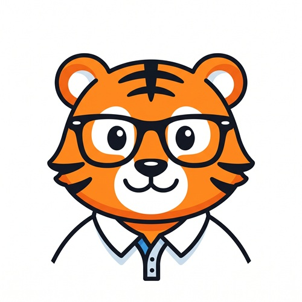

# OT Studio

OT Studio is an Android app for chat, images, and video. It connects your phone straight to AI models at two providers. OpenRouter serves the chat models, while images and video come from Replicate. You bring your own keys. Each provider bills you directly for what you use.

The app keeps your keys encrypted on the phone. Each key goes only to the provider it belongs to. OT Studio has no server of its own. It collects no analytics.

## Requirements

OT Studio needs Android 10 or later and an internet connection. Most phones sold since 2019 qualify. You also need an OpenRouter account for chat and a Replicate account for images and video. Both bill in advance, so each needs a small amount of credit before the first request.

## Start here

New users should read [Getting Started](Getting-Started.md) first. It covers installation, keys, typical costs, and the limits of the app.

## How each screen works

Every screen has a design page. Each one explains what every box on that screen holds and why it is there.

- [Design System](Design-System.md): colors, type, shapes, and the reasons behind them
- [Splash Screen](Design-Splash-Screen.md)
- [Main Screen](Design-Main-Screen.md): the mode switch, setup card, feed, and message bar
- [Output Actions](Design-Output-Actions.md): View, Save, Share, Use as, Upscale, and the job buttons
- [API CALL Panel](Design-API-CALL-Panel.md): models and their inputs
- [Settings](Design-Settings.md): providers, keys, the save folder, and About
- [Model Manager](Design-Model-Manager.md): chat models that run on the phone
- [Help Screen](Design-Help-Screen.md)
- [LoRA Library](Design-LoRA-Library.md)

## Procedures

Each procedure walks through one workflow, tap by tap.

1. [Generate a Photo](Procedure-Generate-a-Photo.md)
2. [Generate a Photo From a Reference Photo](Procedure-Photo-From-a-Reference.md)
3. [Create a Photo Set for LoRA Training](Procedure-Create-a-LoRA-Training-Set.md)
4. [Train a LoRA and Use It](Procedure-Train-and-Use-a-LoRA.md)
5. [Turn Frames Into Video](Procedure-Frames-to-Video.md)
6. [Keep a Face Consistent Through a Video](Procedure-Consistent-Face-Video.md)

## Releases

The [Revision Log](Revision-Log.md) lists the main changes in each version. The [Roadmap](Roadmap.md) lists the changes under consideration for later versions. Signed APK files live on the repository's [Releases](https://github.com/Orangeriger1998/OTStudio/releases) page.

## License

OT Studio is free software under the GNU General Public License, version 3. It comes with no warranty. The license covers the code, while the OT Studio name and artwork stay with OrangeTiger.
